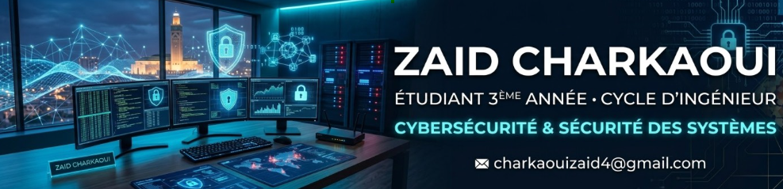

<!-- Bannière en haut du profil -->

  

<h1 align="center">Hi 👋, I'm Zaid Charkaoui</h1>
<h3 align="center">
  Cybersecurity Engineering Student (5th Year - EMSI) 🛡️ 
  SOC / Blue Team • Penetration Testing • DevSecOps
</h3>

---

### 👨‍💻 About Me

- 🔭 **Currently working on:** Multi-Cloud Detection & Automated DFIR Lab (AWS, Azure Sentinel, Terraform) & AI Red/Blue Teaming Lab (LLM/RAG Security)
- 🏢 **Previous Experience:** Penetration Testing Intern at **NTT DATA** (Web & API Security Audit - OWASP, Burp Suite)
- 🌱 **Currently exploring:** Cloud Security, Automated Incident Response (Python/Boto3) & SDN Network Segmentation
- 💬 **Ask me about:** SIEM/SOC (Wazuh), Web Pentesting, Linux Security, Docker & Python
- 🎯 **Open to:** On-site **PFE Internship** (4+ months, starting February 2027) in SOC, Pentest, or DevSecOps
- 📫 **Reach me at:** charkaouizaid4@gmail.com
- 📄 **[Download My CV](CV_Zaid_Charkaoui_SOC_BlueTeam_reduce.pdf")**

---

### 🚀 Featured Cybersecurity Projects

- **🛡️ Red Team / Blue Team SOC Lab:** Multi-VM Cyber Range with Wazuh SIEM/IPS, ModSecurity WAF & Auditd to detect and block SQLi, brute-force, ransomware, and privilege escalation.
- **🤖 AI Red Teaming & Blue Teaming Lab:** Python, LangChain & ChromaDB environment simulating prompt injection and RAG data exfiltration with automated security guardrails.
- **🌐 Enterprise Network Segmentation & QoS (PFA):** Linux network namespaces, Open vSwitch, SDN controller, QoS rate limiting, and traffic auditing with `tcpdump`.
- **☁️ Cloud-Native SOC & Automated DFIR:** Detection engineering and automated response using AWS, Azure Log Analytics, Terraform, and Stratus Red Team.

---

### 🛠️ Tech Stack & Tools

  
  
  
  
  
  
  
  
  

---

### 🌐 Connect With Me

  
  

